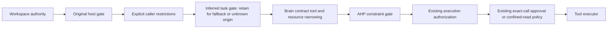

# Assignment 4 security preflight: authorization replacement

Status: plan and test matrix only; implementation requires review. No permission behavior has changed.

Baseline: `main` at `3cc27eb5867b0716e4d0c04c65548f79d40c654d`, the merge of PR #112 with reviewed head `d225975b9300ba6c2e6c55dd7a2f455167b57051`. The merge parents are `af035c8` and `d225975`; both merge and reviewed head have tree `c0f84cdd65c367e4d13aa54620ac48202d608b0d`. Ancestry and full-tree equality were verified with Git.

Post-merge [CI](https://github.com/junkyard22/Orca/actions/runs/44130409187) passed Build & Test and Dependency Audit; [Secret Scan](https://github.com/junkyard22/Orca/actions/runs/44130408987) passed. These are push runs for the merge SHA, not the earlier PR runs.

## Handoff reviewed and scope

The owner confirmed that the handoff on merged main is authoritative. This preflight reviews that canonical [Assignment 4 handoff](ORCA_TASK_CONTRACT_CODEX_HANDOFF.md#assignment-4--narrowing-by-kind-the-contract-supersedes-inferred-permissions-defect-f-05-permission-half--design) and associated design at the baseline above, including the correction separating host/workspace gates from inferred task permissions.

The handoff is correct that both replacement authority and removal of the inferred gate must land together. Its current details are insufficient to prove that replacement safe. The findings below are proposed clarifications for review, not authorization to implement them.

Assignment 4 must retain Benson's inference for fallback, legacy, and runner callers. Its physical deletion remains Assignment 8. For Brain-sourced desktop tasks, only restrictions proven to originate from Benson's inference may be superseded. Explicit caller restrictions, host restrictions, tool inventories, workspace rules, approvals, and task lifecycle restrictions remain independent upper bounds.

## Current authorization path

Line references below describe the merged baseline and will drift after implementation.

| Stage | Current production behavior and source |
|---|---|
| Intake | [`intent.ts:198`](../packages/benson-core/src/intent.ts#L198) produces `['read']`, adding `write`, `shell`, and `network` from regex matches; the legacy audit-shaped permission exception remains. [`buildTaskSpec:279`](../packages/benson-core/src/intent.ts#L279) attaches that array. These are inferred task restrictions, not host grants. |
| Cargo before runtime | [`enrichTaskWithCargo:91`](../apps/desktop/src/cargoContext.ts#L91) adds `read` for file attachments and `network` for repositories, connectors, or URLs. For object permissions it sets `networkAccess: true`, even if the incoming value was false. This is current behavior, not an approved independent authorization source. |
| Normalization | [`helpers.ts:28`](../packages/orca-core/src/helpers.ts#L28) converts arrays to booleans; an array always yields `fileRead: true`. Structured booleans are preserved and missing network defaults false. After normalization, there is no trusted provenance distinguishing keyword-produced limits from structured caller limits. |
| Runtime gates | [`runtime.ts:247`](../packages/orca-core/src/runtime.ts#L247) creates a Miranda task-permission gate with all four flags and the complete configured connector tool list. At 261–262, it composes `workspaceAuthority -> deps.gate -> taskPermissionGate`; each can refuse. `deps.gate` may contain host allowlists, model restrictions, budgets, protected paths, or other policy, not just the desktop's current default configuration. |
| Runtime context | [`runtime.ts:379`](../packages/orca-core/src/runtime.ts#L379) separately filters the tool service by explicit `toolsAllowed`; `[]` removes it. `ctx.toolNamesAllowed` retains that cap. `ctx.gate` contains the full chain. Approval refusal recording, lifecycle tracking, workspace protection, and evidence observation are additional context/wrappers outside that gate. |
| Loaded inventory | Tool bootstrap exposes successful core/static/MCP loads. Disabled or failed MCP loads are unavailable. [`main.ts:1951`](../apps/desktop/src/main.ts#L1951) collects all MCP plus static web/GitHub names for connector classification. Credentials and successful loading establish availability, not permission. |
| Role/task tool selection | [`selectToolsForRole:741`](../apps/desktop/src/main.ts#L741) intersects loaded tools with the static role allowlist and `ctx.toolNamesAllowed`. No contract filtering exists yet, except conversation workers get zero tools at 975. The settings-to-allowlist loop at 1957 ignores an explicitly empty role list; this must be accounted for, not assumed fail-closed. |
| Contract | Maestro fixes the original contract before dispatch. Its ceiling is derived from selected role tools; kind, needs, prohibits and workspace produce available/withheld records. These records currently do not replace permission enforcement. A capability absent from `needs` is generally absent from both available and withheld; absence from withheld is not permission. |
| AHP | [`createWorkerPacket:756`](../apps/desktop/src/main.ts#L756) creates or reuses worker packet constraints. `no_file_writes` currently comes from the command/change heuristic, not contract kind. [`constraintGateFor:59`](../apps/desktop/src/workerConstraints.ts#L59) refuses only the exact tool `write_file` for that constraint. MCP write names can pass this constraint; other gates may still refuse them. |
| Worker gate | [`runRoleWorker:995`](../apps/desktop/src/main.ts#L995) composes `ctx.gate` with the per-child AHP constraint gate. This preserves the host, workspace, inferred/structured permissions and AHP enforcement today. |
| Resolution and gate | [`ReactAgentAdapter:1174`](../apps/desktop/src/agents/ReactAgentAdapter.ts#L1174) resolves calls only against tools actually supplied to the worker, including aliases. It gates the canonical resolved tool and arguments at 1209. Unknown calls do not execute. Invalid argument checks, cancellation and task tracking occur before execution. |
| Execution authorization | [`main.ts:1887`](../apps/desktop/src/main.ts#L1887) wraps every worker tool with `enforceToolAuthorization` before dispatch. [`toolAuthorization.ts:169`](../apps/desktop/src/toolAuthorization.ts#L169) permits recognized confined local operations/reads, denies path escapes and sandbox reconfiguration, and requires per-call approval for external writes, MCP process execution, and unknown capabilities. These rules do not replace request-level resource limits. |
| Final executor | Core file tools use link-aware [`resolveWorkspacePath`](../packages/workbench-core/src/tools/workspacePath.ts#L41). [`runCommandTool.ts`](../packages/workbench-core/src/tools/runCommandTool.ts) validates cwd and applies the existing command policy: confined reads or host-configured allowances may run unattended; other commands require explicit approval and fail closed without a handler. MCP execution remains behind the application wrapper; do not infer OS isolation from its cwd. |
| Result/evidence | After a call, the worker invokes `afterToolRun` and records host observations; `_fsEvidence` and `_execAuthority` cannot come from model arguments. A denied call cannot receive an execution/success receipt. Pappy remains the verifier, not the authorizer. |

Additional paths that must remain covered:

- The desktop `toolService` at [`main.ts:1912`](../apps/desktop/src/main.ts#L1912) independently applies the host gate and execution authorization; runtime/shared-loop callers must also retain the task/contract restrictions upstream. The runtime `ctx.tools.execute` wrapper itself tracks lifecycle and allowlists, not resource permissions; the shared loop supplies its pre-call gate. Do not accidentally create a new task-scoped service caller without that enforcement. Filtering only a prompt is insufficient.
- The shared agent loop gates both its normal and rescue tool dispatches (`loop.ts:241` and `466`). The desktop shared-loop adapter forwards `ctx.gate`. Any future use of that path must inherit the same final tool restrictions.
- Cargo URL/previous-run resolution runs before Brain under [`runGatedCargoRead:2054`](../apps/desktop/src/main.ts#L2054), with an explicit read-only resource gate and network true, plus the host gate and execution authorization. This is a separate host-selected attached-resource flow; a worker contract must not retroactively grant it authority or use it to bypass a denial.
- The runner's [`resolveRoleToolNames:744`](../apps/runner/src/adapters/maestroAdapter.ts#L744) still consumes normalized task permissions. With permissions absent, it retains its role baseline; several baselines include write/shell. Removing inference globally before runner migration would therefore be unsafe.

## Findings and corrections required before implementation

### 1. Removing the whole task gate loses explicit restrictions

The current gate contains more than Benson inference: it can enforce explicit structured `fileRead`, `fileWrite`, `shellExec`, and `networkAccess` limits. Extracting only `deps.gate + workspaceAuthority` and using that for every Brain contract would discard those caller restrictions. `toolsAllowed` happens to be a separate cap and must remain too.

Introduce trusted host-side provenance at the desktop intake boundary, or an equivalent separation of independently owned limits. Default unknown/legacy provenance to retaining existing restrictions. Never take that provenance from Brain output, task text, Cargo data, or a model-writable `context` key. An array is not proof of Benson origin: structured callers can supply legacy arrays too.

The retained chain must reference the actual host gate, not recreate a fresh default Miranda gate. Trace inspection confirms that the current runtime adds workspace authority and task permission gates; lifecycle, refusal recording, and tool authorization are outside that chain and must be preserved as well.

### 2. `not withheld` cannot be the grant rule

The handoff's `shellExec: true unless prohibited` can broaden an inspect task from Benson's `shellExec: false` even when Brain requested no shell. Likewise a modify kind alone must not imply write permission if the corresponding need/ceiling is missing.

Require positive resolved eligibility for **write, shell and external access**: a matching need, an actual role/caller ceiling, no prohibition, and a permitted kind, intersected with retained host/structured limits. Local file reads may retain the existing read-only baseline and structural inspection floor within those limits; that does not authorize a connector that happens to classify as `filesystem-read`. Preserve fallback behavior exactly. Compute the role ceiling before applying contract narrowing, so the contract cannot redefine its own ceiling.

Use existing Miranda `allowedTools` enforcement for the final per-worker tool names as well as resource flags. Gate and dispatch must agree; an omitted schema does not authorize a fabricated or aliased call. Keep the AHP constraint for the record, but do not use its exact-name check as the only write control.

### 3. The classification layers disagree

Read-only probes of existing functions, without executing tools, produced:

| Tool | Maestro capability | Miranda permission requirement with full connector inventory |
|---|---|---|
| `github-mcp_run_workflow` | `shell` | `connector_write` |
| `mail_get_email` | `filesystem-read` | `connector_read` |
| `mail_send_email` | unclassified | `connector_write` |

In the same probe, the current read-only task gate denied file writes, shell and these connector calls; a default host gate without task limits allowed all of them **at the gate layer**. This is not evidence that external mutations would execute: the separate approval wrapper still applies. It demonstrates why removing the task gate is not a safe replacement policy.

Retain the complete connector inventory and stable server identity from host-loaded tools. Do not determine external-read authority solely from Maestro's generic filesystem capability, omit unknown tools from the denial policy, or let a shared `fileWrite` flag authorize an unrelated connector domain. Resolve classification disagreement conservatively in adapter-owned per-tool narrowing, using existing Miranda APIs. Any change to canonical classifiers would exceed the stated no-Miranda-change scope and must be separately reviewed.

### 4. Cargo selection and credentials are not grants

D2 was previously approved with the requirement that connector reads be needed, attached, enabled, and independently authorized. Its independent authorization source must be explicit in the implementation; the current host gate has no general positive network grant configured. Cargo attachment, successful tool loading, a token in Settings, and a keyword match do not substitute for that source.

For each external read, require the matching contract need and exact attached resource/connector, a loaded/enabled tool within the role and caller caps, and a retained explicit host/caller authorization. If no independent authorization can be established, refuse rather than default network true. Preserve current per-call approval for external mutations in addition to contract eligibility. Connector A must not authorize connector B. A repository attachment must be bounded to its provider/resource scope where that scope can be established.

The Cargo enrichment helper currently overwrites explicit object `networkAccess: false`. Correcting that for the Brain-contract path requires a reviewed addition to the handoff's file scope (`cargoContext.ts` and its tests, or equivalent preservation at the trusted wrapper before enrichment). Fallback compatibility must be stated explicitly; do not silently widen or globally delete inference.

### 5. Shell access is host access

An approved shell or MCP process can write files or use the network even when ordinary file-write/network tool flags are false. Neither the workspace cwd nor `no_file_writes` confines it. The regression claim must be: removing inference cannot introduce **unapproved dispatch or unattended effects**. It cannot promise OS-level prevention of effects after an informed, exact-call host-process approval.

Keep confined-read checks, host-access warning, exact-argument/cwd approval binding, denial/timeout/cancellation behavior, and refusal reuse through repairs. Do not use the contract as an approval, add session-wide approvals, or change command policy.

### 6. The handoff needs one unambiguous composition

Item 2 names `ctx.gate`; item 3 says bypass its inferred task gate for Brain contracts. Resolve this as a policy partition, not an unconditional substitution:

This shows conjunctive policy stages, not a new runtime or a claim that every tool requires approval. All six Miranda hooks must retain host enforcement. For a trusted Benson/Brain path only the inferred stage is replaced; structured restrictions remain. Before approval of this plan, no new `hostGate` or permission-origin behavior is implemented.

## Implementation plan for review

1. **Approve the authority partition and scope.** Specify trusted provenance, independent connector authorization, the positive write/shell rule, and empty role allowlist semantics. Retain physical inference until Assignment 8. No partial merge may remove the old gate before its replacement is enforced.
2. **Add failing public-behavior regressions first.** Extend the existing real desktop adapter/runtime harness, using scripted model responses, temporary workspace files, executor counters, and approval spies. Assert no underlying effect on refusals, not merely a returned flag. Add the positive authorized cases too. Mark current guards separately from new expected failures.
3. **Partition runtime authority without changing Miranda.** Expose the retained host/workspace chain and preserve explicit caller limits, lifecycle, approval/refusal record, budgets and the original `ctx.gate` for fallback. A missing trusted provenance signal must not activate the replacement. Update desktop declaration mirrors in the same change.
4. **Implement one adapter-owned narrowing decision.** Preserve the role/task ceiling; derive final eligible tool names and flags from the immutable original contract plus retained authority. Use existing Miranda task flags and `allowedTools`, keep complete connector classification data, and compose the AHP gate. Apply the same policy to direct, decomposed, fallback-model and repair workers. Do not rebuild the contract from a repair instruction.
5. **Preserve Cargo boundaries.** Keep attachment availability separate from permission. Retain explicit network denials across enrichment and prevent workers from attaching/enabling a connector to authorize themselves. Keep resource prefetch distinct and bound to explicitly attached resources; no new URL/connector read from message keywords or injected briefs.
6. **Run the matrix and existing security suites.** Run only affected package suites locally, prescribed builds/typechecks/strict contract checks, then repository CI. Verify that forbidden-source paths and lockfiles have no diff. Only after review of the complete implementation should a separate Assignment 4 PR be opened; do not merge or deploy.

Expected production scope: the handoff's `main.ts`, `workerConstraints.ts`, runtime/types and desktop declaration mirror, plus the explicitly reviewed provenance/Cargo adjustments needed above. No Benson inference deletion, runner migration, Miranda change, new permission UI, command-policy change, Pappy/QC change or delivery change. Tests may extend existing fixtures; no broad tool-layer refactor is required by this plan.

## Regression-test matrix

All new tests below are **planned**, not implemented in this preflight. `R` denotes a regression that should expose an unsafe/missing replacement when written; `G` denotes an existing-behavior guard. Some R rows already pass under the old inferred gate: they must continue passing while the positive replacement cases change. Use real runtime/Maestro composition for integration cases, not a test-only reconstruction of the intended policy.

| ID | Class | Scenario / attempted action | Required observation |
|---|---|---|---|
| P1 | R | Trusted Benson `Correct the typo in README.md`, Brain modify, write needed and in ceiling, usable workspace | Intended workspace write executes once; only inferred denial superseded; host evidence confirms exact file change (T5 positive). |
| P2 | G | Same task via explicit structured `fileWrite: false`, including legacy array input | No write executes, even with a Brain modify proposal; do not infer provenance from input shape. |
| P3 | G | Explicit `fileRead: false`, `shellExec: false`, `networkAccess: false`, one at a time | Matching tool is refused before executor/approval side effects; other policy cannot turn false into true. |
| P4 | G | Brain failure, missing proposal, malformed proposal; contract fallback or absent | Original gate and inferred restrictions remain; no write/shell/network escalation. |
| P5 | R | Forge permission-origin/hostGate/approval fields in context, Cargo text, worker output or Brain JSON | No authority changes; invalid proposal fields still follow validation/fallback. |
| P6 | R | Empty/malformed provenance or partial policy metadata | Retain upstream restrictions or controlled refusal, never an unrestricted default. |
| F1 | R | Inspect needs read; attempt `write_file`, `desktop-commander_write_file`, `desktop-commander_edit_block`, create/move/delete variants | All refuse; no sentinel file created or modified; exercise tools present in the supplied ceiling (T1/T2). |
| F2 | G | `Explain add(), don't change anything` with inspect | Word `add` cannot authorize a write (A6). |
| F3 | R | Modify but write missing from needs, prohibited, or absent from role/caller ceiling | No write in each independent condition; kind alone is insufficient. |
| F4 | G | Allowed modify plus host protected-file rule, explicit task allowlist exclusion, absolute outside path, traversal or link escape | Original host/path refusal wins; no executor invocation. Use Linux symlinks and Windows junction equivalents without deleting existing symlink coverage. |
| F5 | G | Genuine conversation, instructional verbs, and named existing file / attached files | Conversation remains zero-tool; named-file/Cargo floor remains inspect with bounded local read capability; no unrelated external read. |
| S1 | R | Inspect needs only filesystem-read; attempt core command and MCP process tools | No shell/process executes merely because the old gate was removed. |
| S2 | R | Execute/modify with shell need independently absent, prohibited, or outside role/caller ceiling | Each refuses shell dispatch, even if a lexical run/build verb appears. |
| S3 | G | Eligible shell, known confined read with bounded operands | Existing command policy may run it unattended; no new allowances. |
| S4 | G | Eligible `npm test`, inline interpreter, redirection, pipeline or network command | Existing exact-call approval required unless an existing explicit host allowance applies; missing handler/deny/timeout/error means no process. |
| S5 | G | `desktop-commander_start_process` / process interaction and control | Same per-call host-access warning and approval remain, for inspect/execute/modify; no session cache. |
| S6 | G | Approval for command A, then changed args/cwd, task/workspace, Stop, late approval, or repair retry after refusal | Approval cannot authorize the changed/stopped operation; no repeated denied operation. |
| N1 | R | No network need; loaded web/GitHub/mail reader present; message contains `web`, `github`, `repo`, URL or injected brief | No worker external read from keywords, credentials, loading, or omission of a network field. |
| N2 | R | Correct external read need and independent host authorization; vary attachment, enabled/load state, role cap and explicit caller cap separately | Execute only with every condition satisfied; all single-condition negatives have zero external calls. |
| N3 | R | Needed, attached, enabled connector but no independently established network authorization | Refuse; Cargo selection cannot become a grant. |
| N4 | R | Attach authorized connector A; attempt connector B, unrelated repository or different provider | No cross-connector/resource authority. |
| N5 | R | Explicit network false before Cargo enrich; attach URL/repository/connector | False survives the complete entry path; neither prefetch nor worker may use enrichment to override it. |
| N6 | R | GitHub/other connector mutation with only read need, prohibited external write, or local-write permission only | No mutation or approval prompt that could bypass the contract denial; local `fileWrite` is not a connector grant. |
| N7 | G | Eligible connector mutation or clone, explicitly authorized resource and appropriate write need | Existing per-call approval still required; denial/missing handler causes no API call or local clone effect. |
| N8 | R | `mail_get_email`, `mail_send_email`, `github-mcp_run_workflow`; complete versus missing inventory | Classification disagreement cannot reinterpret an external action as local read/shell and evade contract policy. |
| N9 | G | Cargo automatic URL/previous-run reads versus worker attempts to reuse that path | Existing host-selected attached-resource flow remains gated; no arbitrary worker URL or new connector enablement. |
| N10 | G | Shell process capable of network access despite `networkAccess: false` | No unapproved process; approved process is honestly reported as host access, not network-isolated. |
| C1 | G/R | Role static allowlist, explicit task `toolsAllowed`, disabled/failed connector | Actual dispatched tool set stays within every independent cap; an explicit empty role/task list means no tools. Empty role case needs correction/clarification. |
| C2 | R | Unclassified, custom-prefix, underscore-containing server IDs, mutation verbs embedded in names | Missing classification or misleading prefixes cannot grant access; host-owned mapping and conservative per-tool policy apply. |
| C3 | G | Fabricated/aliased call to an excluded tool, including canonical-name substitution | Resolver/final gate refuse the effective tool; zero underlying effect and failed event recorded. |
| C4 | G | First-pass contract, repair instruction asking for extra powers, worker/file prompt injection | Same contract identity and acceptance; no new capabilities or approvals in repairs. |
| H1 | G | Host gate denies each of six hooks independently | Host before/after LLM, before/after tool, before/after QC enforcement remains; no callback for a denied precondition. |
| H2 | G | Missing/deleted/invalid workspace; absolute nested paths, JSON strings for path arrays, schema mismatch | Existing workspace/schema refusals occur first; no cwd fallback or tool-granted root. |
| H3 | G | Direct worker, decomposed child, targeted repair, role/model fallback, runtime tool service, shared-loop dispatch | Same effective resource limits and caps apply in every used path. |
| H4 | G | Cancellation, blocked AHP lifecycle, budget refusal, approval refusal, unsuccessful tool result | No late dispatch, lost refusal record, fabricated receipt or successful evidence for an unexecuted call. |
| H5 | G | Pappy FAIL/WARN, disputed contract and ordinary conversation D8 | Verdict, findings, delivery and repair policy remain unchanged by authorization work. |
| L1 | G | Runner and structured callers while desktop replacement is enabled | Same normalized permissions, role caps and keyword inference remain until runner migration; no global deletion in Assignment 4. |

## Test placement and validation

- Extend `apps/desktop/src/contractRouting.test.ts` or add the handoff's `contractAuthority.test.ts` for real composition (P/F/S/N/C/H integration rows). Give tools observable temp-file/process/API counters; no real connector traffic or live models are needed. Include one eligible positive for each protected resource so an always-deny implementation cannot pass.
- Extend `workerConstraints.test.ts` for observable contract-gate denial, preserving the existing packet constraint implementation. Reuse `toolAuthorization.test.ts`, `verifiedToolExecution.test.ts`, `toolExecutionIntegrity.test.ts` and `approvalBroker.test.ts` unchanged as guards for the final executor/approval boundary.
- Extend `orca-core/runtime.test.ts` for trusted gate partition, explicit limits, fallback, all host hooks and repair identity; keep helper normalization and tool-filter tests. Extend Cargo tests for enrichment and exact attached-resource selection. Existing Miranda workspace, argument and permission suites remain unchanged.
- After approved implementation: run each touched package's complete Vitest suite; existing relevant security suites for Miranda/workbench/runner; `pnpm -r build`; `pnpm -r exec tsc --noEmit`; `pnpm typecheck:scripts`; `pnpm contract:check:strict`; whitespace and forbidden-path diffs; then full CI on the exact review head. Do not weaken tests to bypass host-specific failures or broaden into benchmarks.

## Evidence collected during this preflight

Only read-only analysis, gate-only probes, existing tests, and documentation edits were performed. Existing test commands ran from the preserved `d225975` checkout, whose tracked tree is byte-identical to the merged baseline; no new Assignment 4 tests or permission implementation were written.

| Existing baseline check | Result |
|---|---|
| Desktop authorization, constraints, verified execution, execution integrity, approval broker and contract routing (6 files) | 120 passed |
| Core normalization/runtime/authorization/tool filter (4 files) | 70 passed |
| Miranda gate/workspace authority/MCP argument suites (3 files) | 104 passed / 3 failed: unchanged `mcpArguments.test.ts` symlink creation raises Windows EPERM at lines 108, 116 and 123; no policy assertion failed |
| Preflight contract check | CLEAR on clean merged baseline |
| Post-merge Build & Test / Dependency Audit / Secret Scan | All passed on `3cc27eb` |

These baseline passes do not prove the proposed replacement safe. The new matrix is the proof obligation for the implementation, and review of this preflight remains the next gate. No deploy or release.
